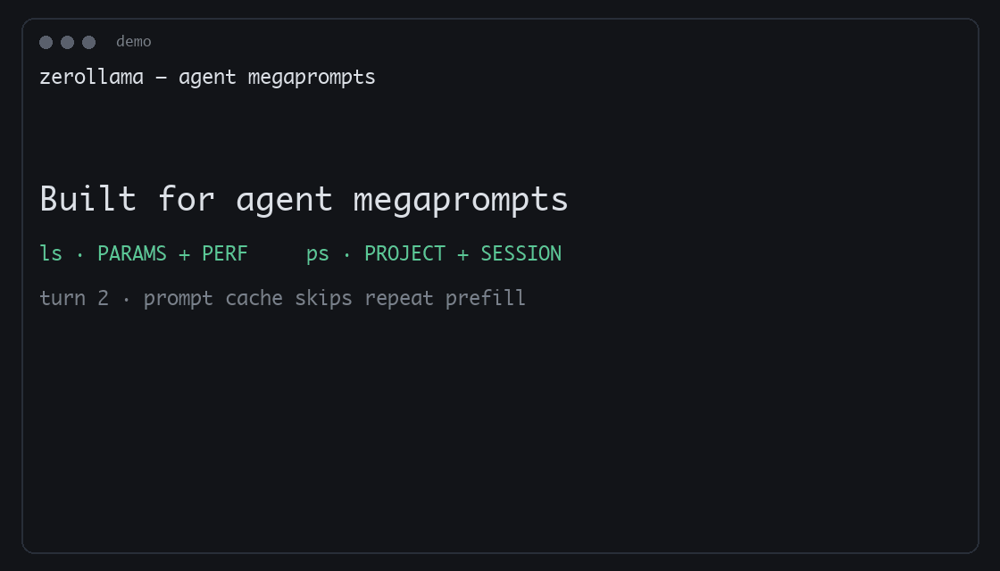

<p align="center">
  
</p>

# Zerollama

**Built for agent megaprompts — not toy chat windows.**

Your agent pastes a novel of tools and history every turn. Zerollama makes that feel fast, and can draw, clip, and talk back on the same server — **and it’s still backwards compatible with [Ollama](https://github.com/ollama/ollama)** (same CLI, REST, and clients).

> **Not upstream Ollama.** Build from this repo (`./zerollama`), not [ollama.com/install.sh](https://ollama.com/install.sh). If you only want “pull a model and chat” once, use [upstream](https://github.com/ollama/ollama).

## How Zerollama differs from upstream Ollama

Same CLI, REST, and clients. Upstream is the local chat daemon. Zerollama is that daemon once the prompt is a novel, someone is talking, and the same process has to draw or cut a clip without kicking the agent off the GPU.

| | **Upstream Ollama** | **Zerollama** |
|---|---|---|
| **Long turns** | Prefix cache reuses a repeated start | Faster tokenize before that cache runs (~3–7×; Qwen2 chat **389→81 ms** on a 1 MiB prompt). Several follow-ups can branch off one copy of the opening. |
| **Lots of chats, same instructions** | If the last request left that exact text in memory, the next one can skip rereading it. A busy server may already have forgotten. | Give each chat a name. The next message in that chat skips rereading the long instructions and tools. A different chat that uses those same instructions can skip them too. Restart within about an hour and it can still remember. |
| **Talking** | Send a recording and the chat model can write down what it heard. | A live conversation: it waits until you pause, answers out loud, and starts the first words while it is still finishing the sentence. Talk over it and it stops. You can also turn writing into a voice, or a recording into writing. |
| **A song** | | Ask for a song and get the audio back (Mac mlx-audio; Linux Wan2GP path). That work runs beside chat. |
| **Pictures and video** | Show it a picture in the chat. | Draw a picture. Watch a video you send and answer about it. Make a short video. |
| **Where is the thing** | | Name something in a picture (“cup”, “person”) and get a box around it, instead of a paragraph describing the scene. |
| **Tag a folder of pictures** | One chat (or embed) per file | `zerollama describe ./photos` writes one JSON for the folder. Same API for a webapp. Resumes after a kill; new files get picked up next run. |
| **Which model for this turn** | You name the model | An auto-router can pick a specialist (or stick with the last good one) from what is loaded. |
| **Odd GGUFs / LAN blobs** | Gallery pull | `zerollama search` / `pull pirateface://…` for Pirate Face torrents. Share blobs on the LAN with `storage serve` (discover / doctor). |
| **A busy GPU** | One queue | Live chat jumps ahead. `ps` shows who holds the card. Training waits until the line is quiet; chat exports become SFT rows; GRPO is a job kind. |

Deeper comparison: [ollama-diff.md](docs/upstream/ollama-diff.md).

<p align="center">
  
</p>

## Quick start

**Apple Silicon:**

```bash
git clone <this-repo> zerollama && cd zerollama
./scripts/runtime/dev_bootstrap.sh
./zerollama serve
./zerollama pull llama3.2:3b
./zerollama run llama3.2:3b
```

**CUDA** / **Arc** → [Building](#building)

```bash
./zerollama doctor
curl -s http://127.0.0.1:11434/api/tags | jq .
```

Default listen `:11434`. Point Hermes / OpenClaw / **Grok Bot** / Open WebUI / Continue at `http://127.0.0.1:11434`.

```bash
zerollama launch claude      # Claude Code, Codex, Copilot, OpenCode, …
zerollama launch openclaw
zerollama launch hermes
# Grok Bot — set its local / OpenAI-compatible provider to http://127.0.0.1:11434
```

Same [ollama-python](https://github.com/ollama/ollama-python) / [ollama-js](https://github.com/ollama/ollama-js) clients. Community catalog: [ollama/ollama § Integrations](https://github.com/ollama/ollama#community-integrations).

## Features

### Huge prompts get cheaper before the first token

The slow part of a megaprompt is often the chew, before any token comes back. Several questions can also share one copy of that opening in GPU memory.

| Plain idea | Under the hood |
|------------|----------------|
| Chew huge prompts faster | Faster tokenizer ([Gigatoken](https://github.com/chynggi/gigatoken-llama.cpp)-inspired) — lab **~3–7×**; Qwen2 chat **389→81 ms** on a 1 MiB prompt |
| Many questions, one shared story | MultiDecode — keep one copy of the shared start in GPU memory and branch answers from it (`POST /v1/multidecode`). Hermes batch can do this automatically when questions share a long opening |
| Keep a tool thread from splitting that opening | Chat compression (auto on tool/think threads): peel fat tool bodies from the newest end first so the shared opening stays identical; sticky `elide_from` stops the next turn from re-pasting full tools |

→ [readme-marketing-benches.md](docs/design/serving/readme-marketing-benches.md) · [faster-bpe-tokenize.md](docs/upstream/faster-bpe-tokenize.md) · [multidecode-llama-cpp.md](docs/design/surfaces/multidecode-llama-cpp.md)

### The long instructions get read once

Every agent message starts with the same pile of tools and rules, then a short new question. Reading that pile is the slow part. One chat can skip it when the text is still in memory. A room full of chats needs a name on each one, or the server forgets whose pile it was.

| What you want | What happens |
|------|-----|
| Same chat, next message | Send a name for the chat (`prompt_cache_key`). The next message skips the pile it already read. Other chats can still use the model in between. |
| Different chat, same tools | Turn on the setting below. The second chat reuses what the first one already read, instead of reading the tools again. |
| You restarted the server | For about an hour that read can be saved to disk, under `~/.cache/zerollama/llama-cache/`. A different model file does not reuse the wrong save. On a Mac this save is off until you turn it on. |
| The chat pastes bigger tool results | New tool text is trimmed from the end, so the instructions at the start stay the same and the skip still works. |
| Draft the next message before it is finished | `POST /api/prefill` with the same messages as the chat. The server reads everything except the last word. The finished `/api/chat` continues from there. |
| The same prompt comes back after llama-server restarts | That process keeps its own copy under `llama.cpp/warm`. It restores the copy only when that is faster than reading the prompt again. A brand-new prompt is the same speed. |

```bash
ZEROLLAMA_L3_PROFILE=agent ./zerollama serve
```

That line is the “different chats share the instructions” setting.

The two disk saves are different. The hour-long one above is the L3 slot bridge, and on a Mac it stays off until the setting. The `llama.cpp/warm` copy belongs to llama-server. The Mac default runner is ggml, so that copy is used when the model is on llama-server (`ZEROLLAMA_LLAMA_SERVER=1`, or Linux serve). **Why a new prompt is unchanged:** these patches restore a prefix. They do not replace the matmul.

→ [gpu-profiles-l3.md](docs/design/serving/gpu-profiles-l3.md) · [radix-prefix-share.md](docs/design/serving/radix-prefix-share.md) · [kinetic-prompt-reuse.md](docs/design/serving/kinetic-prompt-reuse.md)

### Draw it, clip it — same place as chat

Generate images and short videos from the daemon you already pointed your agent at.

| Want | How |
|------|-----|
| Watch a clip | `video_url` / `videos[]` → ffmpeg → vision model |
| Make a video | `POST /v1/videos` — Wan, LTX, H3 families |
| Keyframes without giant JSON | `PUT /v1/media/{session}/{label}` → `options.keyframes` |
| Draw | `/v1/images/*` — MLX (Z-Image), ComfyUI, sd.cpp / OpenVINO |
| Don’t kick the agent offline | Image/video gen defaults to **background** priority |

→ [wan-t2v.md](docs/design/media/wan-t2v.md) · [ltx-t2v.md](docs/design/media/ltx-t2v.md) · [h3-cuda-port.md](docs/design/media/h3-cuda-port.md) · [media-uploads.md](docs/design/media/media-uploads.md)

### Tag a folder of pictures

Point the CLI at a directory. You get one JSON file of labels (SigLIP phrases by default). Optional captions and object boxes. A webapp stores the same catalog and calls `POST /api/describe` with new or changed files only.

```bash
zerollama describe ./photos
zerollama describe ./photos --labels "dog,beach,receipt"
zerollama describe ./photos --caption qwen2.5vl
```

Writes `./photos.json` beside the folder (or `-o`). Same command resumes: unchanged pictures are skipped, new ones are added, missing paths are dropped. HEIC on a Mac goes through `sips` for the model call.

→ OpenAPI `POST /api/describe` · `zerollama describe --help`

### Talk on the same socket

`GET /v1/realtime` is a conversation. The server hears a pause, writes down what you said, and starts speaking the first clause while the rest of the answer is still generating. Talk over it and that reply stops.

| Want | How |
|------|-----|
| Back-and-forth | `pipeline=duplex` — chat model + Whisper or Qwen3-ASR + Piper or Kokoro. The server ends the turn. |
| Live transcription | `intent=transcription` — Voxtral Realtime, LFM3-Audio |
| Read this aloud | `POST /v1/audio/speech` — Piper, Kokoro (`emotion` scales speed), Chatterbox / Orpheus / Irodori, or a GGUF voice: Qwen3-TTS, Pocket TTS, Soprano, LFM3, Drama3 |
| Write down a file | `POST /v1/audio/transcriptions` — Whisper, Qwen3-ASR, Parakeet, Nemotron |
| Hear a clip inside chat | `input_audio` on the message — Gemma4, Qwen-Omni, Ultravox, Voxtral |
| A song | `POST /v1/audio/generations` — MiniMax Music 3 (Mac mlx-audio) |

→ [quick-voice.md](docs/design/media/quick-voice.md) · [multimodal-backends.md](docs/design/media/multimodal-backends.md) · [music-c.md](docs/design/media/music-c.md)

### Pull names, route a turn, make snap judgments

“Who’s mentioned?” “Is this urgent?” “Which model should handle this?” as real answers — not “please reply in JSON” against the chat model.

| Want | API | Engines |
|------|-----|---------|
| Pull people / places / orgs | `POST /v1/extract` · `/v1/gliner` | GLiNER C++/ONNX |
| Yes/no, route, score | `POST /v1/decisions` · `/v1/systemone` | Laya · CLM · OpenJev / DiffusionGemma (opt-in calibrated) · GLiNER-Decide · System One gallery |
| Pick a specialist for this turn | `/api/router/*` · `POST /v1/route` | Auto-router (sticky, multi-question, cross-modal suggest headers) |
| Rank candidates | `POST /v1/rerank` · `/api/score` | LocalAI-style control plane |
| Boxes in a camera frame | `POST /v1/detect` · `/v1/segment` | OWLv2 boxes; segment mask is a stub (`grasp_ready` false) |

→ [gliner-cpp.md](docs/design/surfaces/gliner-cpp.md) · [gliner-decide.md](docs/design/surfaces/gliner-decide.md) · [laya-llama-cpp.md](docs/design/surfaces/laya-llama-cpp.md) · [clm.md](docs/design/surfaces/clm.md) · [diffusion-gemma-llama-cpp.md](docs/design/surfaces/diffusion-gemma-llama-cpp.md) · [detect.md](docs/detect.md) · [segment.md](docs/segment.md)

### One GPU, many agents, less drama

Live chat jumps ahead of background jobs. You can see *who* is holding the card. If something gets bumped, you get a reason you can retry. Training waits until things go quiet. A doctor fixes “broken” models that were really bad templates.

| Want | How |
|------|-----|
| Live work jumps the queue | `qos_class` interactive / auxiliary / background |
| See who holds the GPU | `project_id` → `zerollama ps` PROJECT/SESSION |
| Warm threads stay warm | `prompt_cache_key`, `cache_reset`, `session_parent` |
| Timeouts / kicks you can trust | HTTP **504** vs disconnect **499**; `done_reason=preempted` + reason → retry |
| Schemas that actually stick | Bound `think` + `response_format` / GBNF |
| Load / pin / batch | `/api/can-load`, `/api/propose-load`, **`POST /api/load`**, `/api/pin`, `/api/cache/pin`, Hermes batch |
| “Broken model” that’s a template | `zerollama doctor --repair-models` (minefield traps through 166) |
| Fine-tune without killing chat | `/api/train/*` + idle-wait / defer — chat can pause new ggml loads while a deferred job waits ([t6](docs/design/training/t6-unified-queue.md)) |
| GRPO / RL job kind (lab) | `kind=grpo` dry-run by default; `grpo_run=true` needs `trl` — [t10-grpo.md](docs/design/training/t10-grpo.md) |
| Chat export → SFT rows | `zerollama train recipe` presets: ShareGPT, OpenAI, Alpaca, ChatGPT `mapping`, Claude `chat_messages` — [t11-recipes.md](docs/design/training/t11-recipes.md) |
| Reuse LM Studio downloads | `zerollama list` / `pull` from `~/.lmstudio/models` (GGUF symlink, MLX repack) |
| Multi-shard GGUF | Load models whose weights span several blob files from the manifest |
| Share models across machines | `zerollama fleet serve` · `zerollama storage serve` (lab `:18090`) · `storage discover` / `storage doctor` (mDNS) |
| Pirate Face GGUF | `zerollama search QUERY` · `zerollama pull pirateface://owner/repo[/file.gguf]` |

```bash
curl -s http://127.0.0.1:11434/api/version | jq '{distribution, capabilities: .zerollama.capabilities}'
```

→ [agent-qos-and-project-tracking.md](docs/design/serving/agent-qos-and-project-tracking.md) · [hermes-zerollama-gap.md](docs/design/surfaces/hermes-zerollama-gap.md) · [doctor-model-repair.md](docs/runbooks/doctor-model-repair.md) · [lmstudio-import.md](docs/design/surfaces/lmstudio-import.md) · [t6-unified-queue.md](docs/design/training/t6-unified-queue.md) · [gpu-training.md](docs/design/training/gpu-training.md) · [t10-grpo.md](docs/design/training/t10-grpo.md) · [t11-recipes.md](docs/design/training/t11-recipes.md) · [ollama-diff.md](docs/upstream/ollama-diff.md)

## CLI

Richer `ls` / `ps` than upstream — MoE size, host-safe context, PERF from `bench`, and which harness holds VRAM. Also: `describe` (folder → JSON), `search` / Pirate Face `pull`, `storage`, `train recipe`, `doctor --repair-models`.

```text
NAME                         ID              SIZE      PARAMS                 CTX         PERF     MODIFIED
qwen3-coder-next:6bit        ffc5c8db17e8    64 GB     15.0B MoE 512x10       80k         --       4 minutes ago
ornith-35b-optiq:latest      f4df829f8a75    22 GB     34.0B MoE 256x8        80k         54.2     12 hours ago
```

```text
NAME                       PROJECT                                       SESSION                                             SIZE     PROCESSOR    UNTIL
ornith-35b-optiq:latest    hermes-lean/discord:dm:1516015052568793098    hermes:agent:main:discord:dm:…                      27 GB    100% GPU     29 minutes from now
```

Filters: `zerollama ls image` / `zerollama ls video_gen` · docs: [bench-cache.md](docs/design/serving/bench-cache.md)

## Usage

Vanilla Ollama clients work. On Zerollama, give the chat a name so the next message can skip rereading the instructions, and mark live work so it goes first:

```bash
curl http://127.0.0.1:11434/api/chat -d '{
  "model": "llama3.2:3b",
  "stream": false,
  "messages": [
    {"role": "system", "content": "You are a coding agent. (…long tools + prefs…)"},
    {"role": "user", "content": "Fix the flaky test."}
  ],
  "options": {
    "prompt_cache_key": "hermes-thread-42",
    "zerollama": {
      "qos_class": "interactive",
      "project_id": "hermes-lean",
      "project_name": "demo"
    }
  }
}'
```

```python
from ollama import chat
print(chat(model='gemma3', messages=[{'role': 'user', 'content': 'Why is the sky blue?'}]).message.content)
```

[docs.ollama.com/api](https://docs.ollama.com/api) · harness contract: [agent-qos-and-project-tracking.md](docs/design/serving/agent-qos-and-project-tracking.md)

**Backends:** llama.cpp (ggml Metal/CUDA or Go→llama-server), MLX safetensors, Python runtime (`:8081`). Optional: [Flash-MoE](docs/research/flash-moe.md).

## Building

| Platform | Start here |
|----------|------------|
| **Apple Silicon** | [mac-dev-setup.md](docs/runbooks/mac-dev-setup.md) → `./scripts/runtime/dev_bootstrap.sh` |
| **CUDA** | [cuda-lanes.md](docs/design/serving/cuda-lanes.md) · [5080-runbook.md](docs/runbooks/5080-runbook.md) |
| **Arc** | [a380-runbook.md](docs/runbooks/a380-runbook.md) |

```bash
./scripts/build/build_zerollama_mac.sh
ZEROLLAMA_GPU_JOBS=false OLLAMA_NOPRUNE=1 ./zerollama serve
```

Vendor pin: **`b94959a6` / b12557** — [runtime/LLAMA_CPP_PIN.md](runtime/LLAMA_CPP_PIN.md). After patch edits: `make -f Makefile.sync clean apply-patches && ./scripts/vendor/sync_vendor_llama.sh`.

## Documentation

[docs/README.md](docs/README.md) · [ROADMAP.md](docs/ROADMAP.md) · [CHANGELOG.md](CHANGELOG.md)

| Area | Docs |
|------|------|
| Harness / Hermes | [agent-qos-and-project-tracking.md](docs/design/serving/agent-qos-and-project-tracking.md) · [hermes-zerollama-gap.md](docs/design/surfaces/hermes-zerollama-gap.md) |
| MultiDecode | [multidecode-llama-cpp.md](docs/design/surfaces/multidecode-llama-cpp.md) |
| Decide / extract / see / route | [laya-llama-cpp.md](docs/design/surfaces/laya-llama-cpp.md) · [clm.md](docs/design/surfaces/clm.md) · [diffusion-gemma-llama-cpp.md](docs/design/surfaces/diffusion-gemma-llama-cpp.md) · [gliner-cpp.md](docs/design/surfaces/gliner-cpp.md) · [gliner-decide.md](docs/design/surfaces/gliner-decide.md) · [detect.md](docs/detect.md) |
| Speed | [faster-bpe-tokenize.md](docs/upstream/faster-bpe-tokenize.md) · [gpu-profiles-l3.md](docs/design/serving/gpu-profiles-l3.md) · [kinetic-prompt-reuse.md](docs/design/serving/kinetic-prompt-reuse.md) |
| Voice / music | [quick-voice.md](docs/design/media/quick-voice.md) · [multimodal-backends.md](docs/design/media/multimodal-backends.md) · [music-c.md](docs/design/media/music-c.md) |
| Video / image | [wan-t2v.md](docs/design/media/wan-t2v.md) · [ltx-t2v.md](docs/design/media/ltx-t2v.md) · [h3-cuda-port.md](docs/design/media/h3-cuda-port.md) |
| Train / idle queue | [gpu-training.md](docs/design/training/gpu-training.md) · [t6-unified-queue.md](docs/design/training/t6-unified-queue.md) · [t10-grpo.md](docs/design/training/t10-grpo.md) · [t11-recipes.md](docs/design/training/t11-recipes.md) |
| Serving ideas (not vendor) | [deepinfer-borrowings.md](docs/upstream/deepinfer-borrowings.md) · [deepinfer-ladder.md](docs/upstream/deepinfer-ladder.md) · [deepgemm-borrowings.md](docs/upstream/deepgemm-borrowings.md) · [vllm-borrowings.md](docs/upstream/vllm-borrowings.md) |
| Doctor | [model-serving-minefield.md](docs/runbooks/model-serving-minefield.md) · [doctor-model-repair.md](docs/runbooks/doctor-model-repair.md) |
| Storage / fleet | [remote-model-storage.md](docs/design/surfaces/remote-model-storage.md) · [fleet-management.md](docs/design/training/fleet-management.md) |
| Pin / gallery stamp | [runtime/LLAMA_CPP_PIN.md](runtime/LLAMA_CPP_PIN.md) (**b12557**) · `version.OllamaCompat` |

## Agent skills

**39** [`SKILL.md`](agentskills/README.md) packages so Cursor / Claude / Copilot agents can use zerollama without reverse-engineering the API.

```bash
npx skills add GoodSoftware-Group/zerollama
npx skills add GoodSoftware-Group/zerollama --agent cursor
```

→ [skills/README.md](agentskills/README.md) · [skills/skills.json](agentskills/skills.json)

## Acknowledgments

We reimplement **ideas** in our Go + llama.cpp + runtime shape — we do **not** vendor their servers as required deps.

| Project | What we took |
|---------|----------------|
| **[Gigatoken](https://github.com/chynggi/gigatoken-llama.cpp)** | Fast tokenize — patches **0106–0126** |
| **[vLLM](https://github.com/vllm-project/vllm)** / **[SGLang](https://github.com/sgl-project/sglang)** | Prefix cache + agent multimodal patterns |
| **[DeepInfer](https://github.com/deepseek-ai/DeepInfer)** | Schedule / SWA / speculation **ideas** only (SM100 engine not vendored) — [deepinfer-ladder.md](docs/upstream/deepinfer-ladder.md) |
| **[LocalAI](https://github.com/mudler/LocalAI)** | Control-plane habits (rerank, repair, bench) |
| **[WestCoastML/multidecode](https://github.com/WestCoastML/multidecode)** | Forest decode — patches **0127–0129** |
| **[Kinetic](https://github.com/Veloresearch/kinetic)** | Prompt reuse — patches **0162–0186**. Ideas only; the Rust GEMM kernels stay upstream |
| **[GLiNER.cpp](https://github.com/Knowledgator/GLiNER.cpp)** / **[GLiNER2.5-Decide](https://huggingface.co/fastino/GLiNER2.5-Decide)** | Extract + encoder triage |
| **[Hermes Agent](https://github.com/NousResearch/hermes-agent)** | Harness that needs a real control plane |
| **[model-serving-minefield](https://github.com/Blackwellboy/model-serving-minefield)** | Doctor trap map |
| **[ollama/ollama](https://github.com/ollama/ollama)** / **[llama.cpp](https://github.com/ggml-org/llama.cpp)** | Wire shape + engine (pin **b12557**) |

More: [open-source-shoutouts.md](docs/upstream/open-source-shoutouts.md) · [@spaceodili](https://x.com/spaceodili)

Issues and PRs welcome.

**License:** [MIT](LICENSE) (Ollama lineage).
