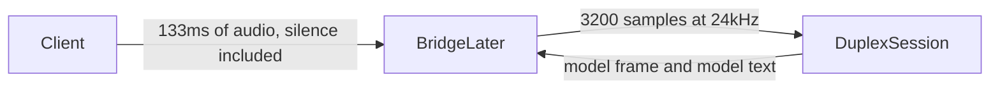

# Haru duplex — native full-duplex speech (design lead)

Zerollama’s shipped voice path is **cascade duplex**: pause, transcribe, answer, speak ([quick-voice.md](quick-voice.md)). [Haru-4B](https://huggingface.co/higurashi-ai/Haru-4B) is a different product — a pretrained full-duplex spoken dialogue model that listens and speaks on the same 133 ms clock. This note records the frame contract and the refusals. It does **not** schedule a Go bridge, a sidecar under serve, or an OpenAPI change.

Sources: [technical blog](https://blog.higurashi.ai/melte/haru4b/), [weights](https://huggingface.co/higurashi-ai/Haru-4B) (Apache-2.0), [code](https://github.com/higurashi-ai/Haru). ROADMAP: [media.md](../../roadmaps/media.md#speech-transcription-and-realtime-voice).

## Why this is a fourth realtime path

`GET /v1/realtime` already means three different things (LFM3-Audio and GGUF TTS projectors sit on the same two sockets as the first two rows):

| Path | What it does |
|------|----------------|
| llama-server proxy (`voxtral_rt` / `StreamOnly` in [`types/model/mtmd_audio.go`](../../../types/model/mtmd_audio.go)) | Live transcription |
| `serveSpeech` (Piper / Kokoro / gen projectors, `CapabilitySpeech`) | Read text aloud |
| `pipeline=duplex` ([`server/voicepipe`](../../../server/voicepipe/session.go)) | Pause → ASR → chat → TTS |

Haru is none of those. A later bridge, if any, is a **new branch** beside `pipeline=duplex` in [`server/realtime.go`](../../../server/realtime.go). It does not add cases inside `voicepipe` `handle`: unknown events fail the socket; `commit` requires `eng.Duplex`; `response.create` speaks a pending text item (Piper/Kokoro path). Cascade VAD, ASR events, and turn commit fight the frame clock.

## What Haru is

One language-model position is one **133 ms** frame at **24 kHz** (**3200** samples). The input is the sum of three streams: the model’s text token, the model’s audio latent, and the user’s audio latent. A lightweight MeanFlow MLP (one step, guidance 1–2) produces the next continuous latent; a causal VibeVoice codec (ratios **8×5×5×4×2×2**) turns it into waveform. There is no RVQ codebook and no second audio transformer.

The backbone is `Qwen3_5TextModel` (vocab **248320**, hidden 2560, 32 layers, hybrid linear + full attention) — the same hybrid layout as [`x/models/qwen3_5`](../../../x/models/qwen3_5). Text specials: pad **248076**, eop **248071**, eos **248044**. `StreamDetokenizer` emits **one space** on the first PAD/EOP of a silent gap and nothing on the frames after; EOS is banned; a call ends at `max_frames` (default 60 min) or when the socket closes. PAD/EOP logits are recomputed in fp32 because bf16 cannot resolve speak vs stay silent.

The prompt is a ChatML system turn (character card, no audio), then a reference clip on the **model** stream only (text is PAD…PAD, EOP on the last frame). `render_card` is the trained layout (persona, name, gender, backchannel, other_name, relationship, situation). Any other system string is in-API and off-distribution. The published model is a conversational base (overlap, backchannels), not an instruction-following assistant.

Checkpoint: one bf16 `model.safetensors` (~10.5 GB; their GPU note ~12 GB) — `lm.*`, `user_audio_proj.*`, `model_audio_proj.*`, `head.*`, `codec.*`.

## Invariants

| Rule | Why |
|------|-----|
| **Whole session outside our runners** | `embed()` sums a token plus two audio projectors, then MeanFlow + streaming codec. [`x/models/qwen3_5`](../../../x/models/qwen3_5) has no `inputs_embeds` path. Do not split the LM into our process. Do not convert to GGUF. |
| **Frame clock** | After `start()` prefills the card and the whole reference (a 3 min clip is ~1350 codec frames), user frame `k` returns model frame `k+1`. Resample by **duration**: 133 ms at 16 kHz is **2133** samples (3200 × 16/24) → 3200 at 24 kHz. Counting 3200 input samples at 16 kHz runs the model slow. A step that overruns 133 ms drifts the call. |
| **Silence ≠ idle** | Quiet audio is a real frame. A client that stops sending is idle. Those are different timers. |
| **Text is the model’s words** | One space at the start of a PAD/EOP gap; empty after. There is no user transcript. Do not emit `conversation.item.input_audio_transcription.*`. |
| **Not an assistant voice** | No `speech` capability (opens `POST /v1/audio/speech` and read-aloud routing for Piper/Kokoro/remote-tts/music3). No `completion`. No stream projector. Cascade duplex stays the tool-using path. |
| **Voice rights** | Reference clip: one speaker, 3 s–3 min, only with the rights to that voice, from a **local path** confined like TTS ref audio. Not an upload on the production socket. |
| **GPU for the call** | Weights hold the GPU until the socket closes. Serve does **not** start the process. Never bind **11434** / **8081**. Their demo port **8998** is a lab port. |
| **Latency claim** | Blog int8 M1 Max: ~**34 ms** one model step, ~**65 ms** mic→headphones **excluding** the 133 ms frame. A reaction waits for one frame to gather, one step, and a playout margin. 5080 step time is unmeasured. 8-bit is `haru_mlx` (`quantize=8` on LM matrices + embedding); CUDA `DuplexConfig` has no weight quant. |

## Listen gate (before any bridge)

Success is **overlap**: model audio continues while user audio is loud, with a backchannel or an interruption. The card’s `backchannel` field is their control. A cascade client that waits on `input_audio_transcription.completed` will hang — that is the wrong test.

First proof: a `DuplexSession` script, or their `haru.server` demo on a lab port (default **8998**). Offline `haru-inference` writes a wav and does not prove live overlap. If the listen fails, stop. This note does not schedule a Go bridge.

## Open on purpose

| Choice | Options | Constraint |
|--------|---------|------------|
| **Host** | Mac `haru_mlx` (Metal kernels); CUDA PyTorch with the torch codec; Triton codec later if sm_120 is measured; vLLM-Omni (`/v1/realtime?duplex=1`, vLLM 0.32) when more than one call must share a GPU | PyTorch and `haru_mlx` share `DuplexSession`. vLLM-Omni shares the **frame** contract and a different wire. No `../Haru` sibling checkout. Do not vendor the repo or reimplement the codec / MeanFlow head. |
| **Wire** | Proxy their vLLM events, their Opus demo socket, or a thin Go map onto our realtime events | Must carry continuous PCM (silence included), the card, a confined reference, model PCM16 at 24 kHz, and the model’s text. Must **not** require `input_audio_buffer.commit`, `response.create`, or server VAD. Field names and query shape stay undecided. No OpenAPI change in this pass. |
| **GPU free** | Same *outcome* as `vram.PrepareForImageGen` in [`server/routes.go`](../../../server/routes.go): chat and the runtime sidecar are gone for the call | Mechanism can wait. |

## Temptations

| Temptation | Why we did not |
|------------|----------------|
| Mark the tag `speech` / `completion` | Opens TTS and chat routes for a voice-cloning conversation model. |
| Load it as Qwen3.5 GGUF / MLX | Config matches; forward does not (`inputs_embeds` + codec + MeanFlow). |
| Put cases in `voicepipe` `handle` | Cascade VAD, ASR events, and turn commit fight the frame clock. |
| Claim 65 ms through the daemon | That number is mic→headphones excluding framing; the step alone is ~34 ms on Mac int8. 5080 unmeasured. |
| Start Haru from `zerollama serve` on production ports | Hands off **11434** / **8081**. Lab only. |
| Ship a product README row before a listen | Cascade duplex stays the shipped “Talk on the same socket” story until overlap is real. |
